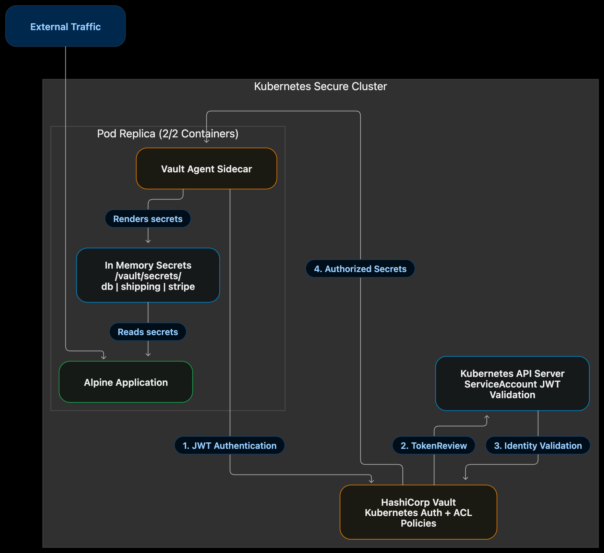

# Vault Kubernetes Identity & Secret Injection Platform

A production-minded platform engineering implementation showing how Kubernetes workloads can authenticate to HashiCorp Vault using their service-account identity, receive tightly scoped short-lived credentials, and consume secrets without persisting plaintext values in Git, config maps, or disk-backed runtime layers.

This project is designed to demonstrate how modern cloud-native teams solve real secret-management problems in a secure, auditable, and scalable way. It reflects the type of architecture expected from platform, cloud, and security engineering teams operating in regulated or high-trust environments.

## Overview

This repository models a modern zero-trust secret delivery pattern for a multi-team platform. It combines:

- Kubernetes workload identity via Vault's Kubernetes auth backend
- Dynamic role-based authorization policies
- Vault Agent Injector for runtime secret injection
- Path-isolated secret storage for different application domains
- Operational auditing and policy review around secret access

## Architecture

```text
[ Kubernetes Cluster Domain ]


      
## What This Project Demonstrates

This repository shows that the engineer understands how to combine several critical platform capabilities:

- Kubernetes identity-based authentication
- Vault policy enforcement and path isolation
- Runtime secret injection using sidecar and init patterns
- Least-privilege access control for multi-team workloads
- Operational observability through audit log review and access validation

These are the same patterns used in modern enterprise environments where security and developer velocity must coexist without exposing private credentials.

## Why This Matters in the Enterprise

In production clusters running hundreds of microservices, application teams often dump database credentials, API tokens, and service keys into general-purpose config maps or hardcoded environment variables. That creates significant blast radius, compliance exposure, and credential-leak risk.

This project addresses that problem by:

1. Enforcing strict path isolation between teams, services, and runtime environments.
2. Replacing static long-lived admin credentials with short-lived workload identity tokens.
3. Injecting secrets into in-memory runtime paths rather than external disk-backed storage.
4. Making access visible and auditable through Vault logging and identity mapping.

## Core Security Pattern

The project follows a dynamic trust model:

- The workload authenticates to Vault using its Kubernetes service-account JWT.
- Vault validates the identity against the configured Kubernetes auth backend.
- A role maps the identity to a scoped policy.
- The workload can read only the secret paths explicitly allowed by policy.
- Secrets are mounted into the running container at runtime, not stored in Git, Kubernetes manifests, or plain text files.

## Key Engineering Decisions

This implementation is intentionally built around a few platform design principles:

- Identity is the trust anchor, not a permanent shared secret.
- Access is segmented by path, workload, and namespace policy boundaries.
- Secret material is injected at runtime only, reducing the risk of long-lived credential exposure.
- Audit visibility is treated as a first-class requirement, not an afterthought.
- Infrastructure-as-code is used to standardize and reproduce secure access patterns across teams.

## Repository Layout

- `main.tf` – Terraform configuration for Vault mount, policies, auth backend, and role bindings.
- `app-deployment.yaml` – example workload with Vault Agent Injector annotations and secret templates.
- `vault-values.yaml` – local Vault Helm values for the dev-mode deployment.
- `modules/vault-app-onboarding/` – reusable Terraform module for bootstrapping credentials per app team.
- `parse_audit.py` – utility script for scanning Vault audit logs for credential access patterns.
- `fix-manifest.sh` – helper used for manifest updates and deployment adjustments.

## Local Demo Workflow

To run this locally in a Kubernetes-oriented dev environment:

1. Start a Vault instance using the provided Helm values or a local dev deployment.
2. Apply the Terraform configuration to create the mount, auth backend, and role-policy mappings.
3. Deploy the sample workload in the cluster using the service account and Vault Agent Injector annotations.
4. Validate that the application sees the injected secrets under the runtime path within the container.
5. Review audit logs to confirm the workload is accessing only the expected secret paths.

> This is a strong demo and learning platform. For production systems, the same pattern would typically be extended with TLS enforcement, hardened RBAC, HA architecture, backup/restore controls, and stricter operational governance.

## Production-Grade Goals

This solution is designed to model the same controls teams expect in enterprise deployments:

- least-privilege path enforcement
- short-lived identity-based credentials
- environment-aware secret segmentation
- runtime-only secret consumption
- audit-friendly access visibility

## Validation and CI

The repository includes a GitHub Actions validation pipeline for Terraform and Python checks. This helps ensure that infrastructure definitions remain structurally valid and that the automation scripts still compile cleanly with each change.

---

This project is intentionally structured as a portfolio-ready security architecture example for Kubernetes and Vault integration work in cloud-native production environments. It demonstrates the engineering thinking expected from teams operating in regulated, multi-service, and high-trust platform environments.
